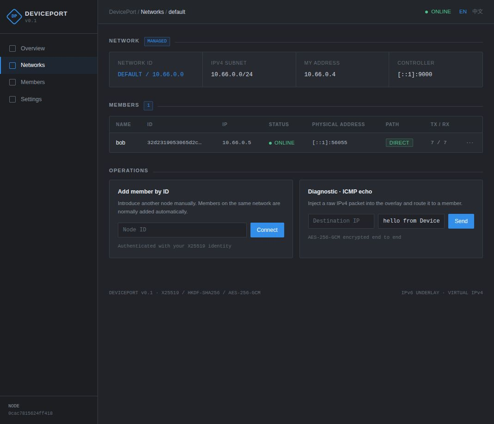
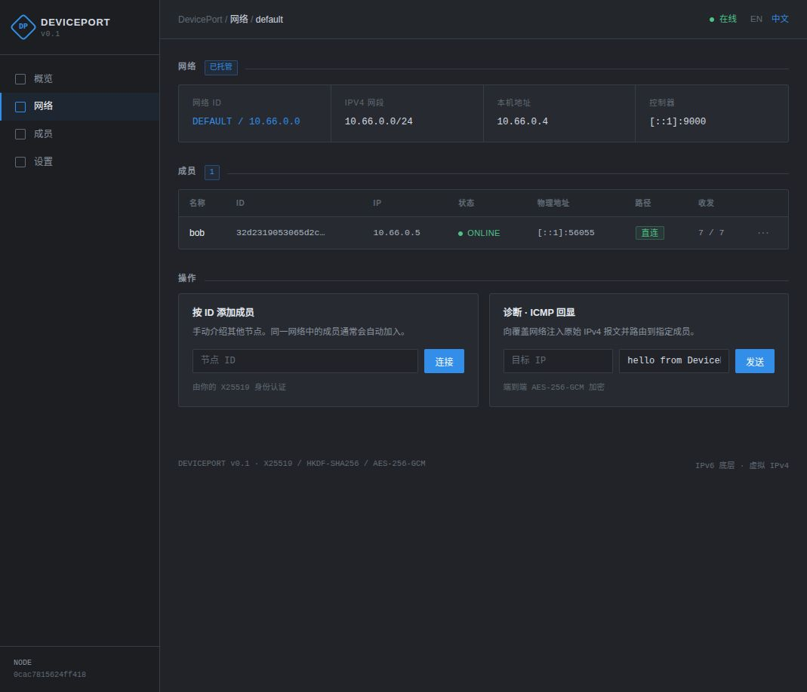

# DevicePort

[](https://github.com/GPUInAntarctica/DevicePort/actions/workflows/ci.yml)
[](LICENSE)
[](CHANGELOG.md)

**English** · [中文](#deviceport-1)

DevicePort builds a virtual LAN over an **IPv6 underlay**. Devices that are not on the
same physical network can join one overlay and receive a virtual **IPv4** address
(`10.66.x.y`). Traffic between peers is **end-to-end encrypted**; connections use
**UDP hole punching (NAT traversal)** with automatic **relay fallback** through the
signaling server. A bilingual (EN/中文) web GUI and an Electron desktop shell are included.

> Status: **v0.1** — functional prototype. It is not yet audited for production use.

## Features

- **IPv6 underlay / IPv4 overlay** — peers discover each other over IPv6 and exchange raw IPv4 packets through a TUN interface.
- **Virtual LAN** — the server allocates one `10.66.<net>.x/24` address per device and introduces peers into a full mesh.
- **NAT traversal** — simultaneous UDP hole punching against all discovered IPv6 endpoints.
- **Relay fallback** — if no direct path can be established, encrypted frames are forwarded by the server (which cannot decrypt them).
- **Encryption** — static X25519 identities + HKDF-SHA256 key derivation + AES-256-GCM per packet; AAD authenticates the frame header.
- **Cross-platform** — Linux (native TUN), Windows (Wintun), Android (VpnService via gomobile), plus a userspace TUN mode used for tests, Wine and demos.
- **GUI** — embedded local web dashboard with EN/中文 switch, peer list, live mode (direct/relay), and a test-packet injector.
- **Desktop app** — Electron shell that starts and supervises the Go daemon and shows the GUI in a native window with tray/menus.
- **CLI & HTTP API** — `/api/status`, `/api/connect`, `/api/send` for automation.

## Architecture

```
            ┌──────────────────────────────────────────┐
            │ Signaling + Relay Server (IPv6 :9000)    │
            │  • IP allocation  • peer introduction    │
            │  • blind relay (no keys)                 │
            └───────────────┬──────────────┬───────────┘
                  TCP control│              │TCP control
              ┌─────────────┘              └─────────────┐
        ┌─────▼─────┐    UDP IPv6 hole punch        ┌─────▼─────┐
        │ Node A    │◀══════════════════════════════▶│ Node B    │
        │ 10.66.1.2 │    AES-256-GCM encrypted       │ 10.66.1.3 │
        └─────┬─────┘                                └─────┬─────┘
           TUN                                          TUN
       virtual IPv4                                  virtual IPv4
```

Control messages are length-prefixed JSON over TCP. Data frames are encrypted UDP
datagrams with a 12-byte authenticated header. See [docs/PROTOCOL.md](docs/PROTOCOL.md).

## Quick start (Linux)

```bash
make build                         # binaries in ./bin

# Terminal 1 – signaling/relay server
./bin/deviceport-server --listen '[::]:9000'

# Terminal 2 – node A
./bin/deviceport --server '[::1]:9000' --name alice --tun auto

# Terminal 3 – node B
./bin/deviceport --server '[::1]:9000' --name bob --tun auto
```

Open <http://127.0.0.1:9050> to see the dashboard. With a native TUN you may need
`sudo` (or `CAP_NET_ADMIN`); otherwise use `--tun userspace`. To force the demo subnet:
`--subnet 10.66.0.0/24` on the server.

| Desktop (EN) | Desktop (中文) |
|--------------|----------------|
|  |  |

| Android (EN) | Android (中文) |
|--------------|----------------|
|  |  |

## Desktop app (Electron)

```bash
cd desktop && npm install && npm run start
# package installers: npm run dist
```

The Electron shell launches `bin/deviceport`, waits for the local API, then shows the
bilingual dashboard in a window. See [docs/DESKTOP.md](docs/DESKTOP.md).

## Windows (tested under Wine)

```bash
make build-windows
WINEDEBUG=-all wine bin/deviceport-server.exe --listen '[::1]:9000'
WINEDEBUG=-all wine bin/deviceport.exe --tun userspace --gui 127.0.0.1:9050
```

Wine cannot load the Wintun kernel driver, so the Windows binary automatically falls
back to the userspace TUN under Wine (control plane, encryption, punching, relay and
GUI are all still exercised). A real Windows host uses Wintun — see [docs/WINDOWS.md](docs/WINDOWS.md).

## Android

Two ways to run on an Android device/emulator:

1. **APK (full VPN app)** — `bash android/build.sh` produces `bin/DevicePort-v0.1.apk`.
   It uses Android `VpnService` for the TUN and a gomobile AAR of the Go engine.
2. **Daemon binary** — push `bin/deviceport-android-*` and run it via `adb shell`
   (userspace TUN mode + Web GUI). Useful for CI and quick checks.

With the Android CLI:

```bash
android emulator create medium_phone
android emulator start --headless medium_phone
adb install -r bin/DevicePort-v0.1.apk
```

See [docs/ANDROID.md](docs/ANDROID.md). Start the server with `--subnet 10.66.0.0/24`
so the app's `VpnService` address (`10.66.0.2/24`) matches the allocation.

## Tests

```bash
make test          # go test ./... — includes direct + relay E2E, crypto, key agreement
```

The E2E test starts a real in-process server and two userspace nodes, verifies direct
hole punching, injects an ICMP packet and checks delivery, then disables the direct
path and verifies relay fallback.

## Repository layout

| Path | Purpose |
|------|---------|
| `cmd/deviceport-server` | signaling & relay server |
| `cmd/deviceport` | client daemon |
| `internal/crypto` | X25519, HKDF, AES-GCM |
| `internal/protocol` | control messages & wire format |
| `internal/server` | server implementation |
| `internal/node` | overlay engine (punch/relay/encryption/TUN loop) |
| `internal/tun` | Linux TUN, Windows Wintun, userspace & FD devices |
| `internal/api` | local HTTP API + embedded bilingual Web GUI |
| `mobile` | gomobile facade for Android |
| `android` | Android VpnService app + manual APK build |
| `desktop` | Electron desktop shell |
| `docs` | architecture, protocol and platform guides |

---

## DevicePort（中文）

DevicePort 使用 **IPv6 底层网络**构建虚拟局域网。不在同一物理网络的设备可以加入同一个覆盖网络，
并获得虚拟 **IPv4** 地址（`10.66.x.y`）。节点间流量**端到端加密**，通过 **UDP 打洞（NAT 穿透）**
建立直连，失败时自动回退到**中继**。项目包含中英双语 Web 控制面板和 Electron 桌面客户端。

> 当前版本：**v0.1** — 功能完整的原型，尚未经过生产安全审计。

### 功能

- **IPv6 底层 / IPv4 覆盖**：通过 IPv6 发现对端，经由 TUN 接口收发 IPv4 原始报文。
- **虚拟局域网**：服务器为每台设备分配 `10.66.<net>.x/24` 地址，并自动介绍节点组成全互联。
- **NAT 穿透**：同时向所有发现的 IPv6 端点发送 UDP 探测包进行打洞。
- **中继回退**：无法直连时由服务器转发加密帧（服务器无法解密）。
- **加密**：静态 X25519 身份 + HKDF-SHA256 密钥派生 + AES-256-GCM 逐包加密；帧头参与认证。
- **跨平台**：Linux（原生 TUN）、Windows（Wintun）、Android（VpnService + gomobile），以及用于测试/Wine/演示的 userspace TUN。
- **图形界面**：内嵌本地 Web 面板，支持中/英切换、节点列表、直连/中继状态和测试包注入。
- **桌面应用**：Electron 外壳启动并管理 Go 守护进程，提供原生窗口、托盘和菜单。
- **CLI / HTTP API**：`/api/status`、`/api/connect`、`/api/send` 便于自动化。

### 快速开始（Linux）

```bash
make build
./bin/deviceport-server --listen '[::]:9000'                    # 终端 1
./bin/deviceport --server '[::1]:9000' --name alice --tun auto  # 终端 2
./bin/deviceport --server '[::1]:9000' --name bob --tun auto    # 终端 3
```

浏览器打开 <http://127.0.0.1:9050> 查看面板。原生 TUN 需要 root 或 `CAP_NET_ADMIN`；
否则使用 `--tun userspace`。演示时可给服务器加 `--subnet 10.66.0.0/24`。

### Windows（Wine 测试）

```bash
make build-windows
WINEDEBUG=-all wine bin/deviceport-server.exe --listen '[::1]:9000'
WINEDEBUG=-all wine bin/deviceport.exe --tun userspace --gui 127.0.0.1:9050
```

Wine 无法加载 Wintun 内核驱动，因此 Windows 程序在 Wine 下会自动回退到 userspace TUN
（控制面、加密、打洞、中继和 GUI 仍可完整测试）。真实 Windows 使用 Wintun，详见 [docs/WINDOWS.md](docs/WINDOWS.md)。

### Android

1. **APK（完整 VPN 应用）**：`bash android/build.sh` 生成 `bin/DevicePort-v0.1.apk`，使用 `VpnService` 创建 TUN，Go 引擎通过 gomobile AAR 集成。
2. **守护进程二进制**：推送 `bin/deviceport-android-*` 后用 `adb shell` 运行（userspace TUN + Web GUI）。

Android CLI 创建并启动模拟器：

```bash
android emulator create medium_phone
android emulator start --headless medium_phone
adb install -r bin/DevicePort-v0.1.apk
```

服务器请使用 `--subnet 10.66.0.0/24`，使应用内 `VpnService` 地址（`10.66.0.2/24`）与分配一致。

### 测试

```bash
make test
```

端到端测试会在进程内启动服务器和两个 userspace 节点，验证直连打洞、ICMP 包投递，
然后关闭直连路径验证中继回退。

## License

[MIT](LICENSE)
