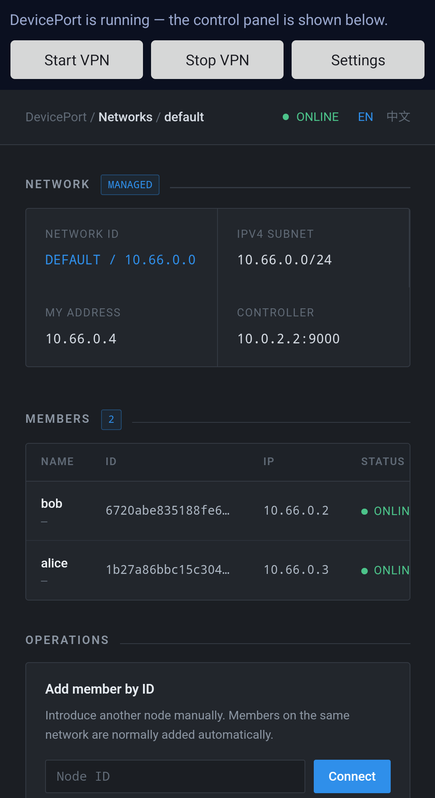
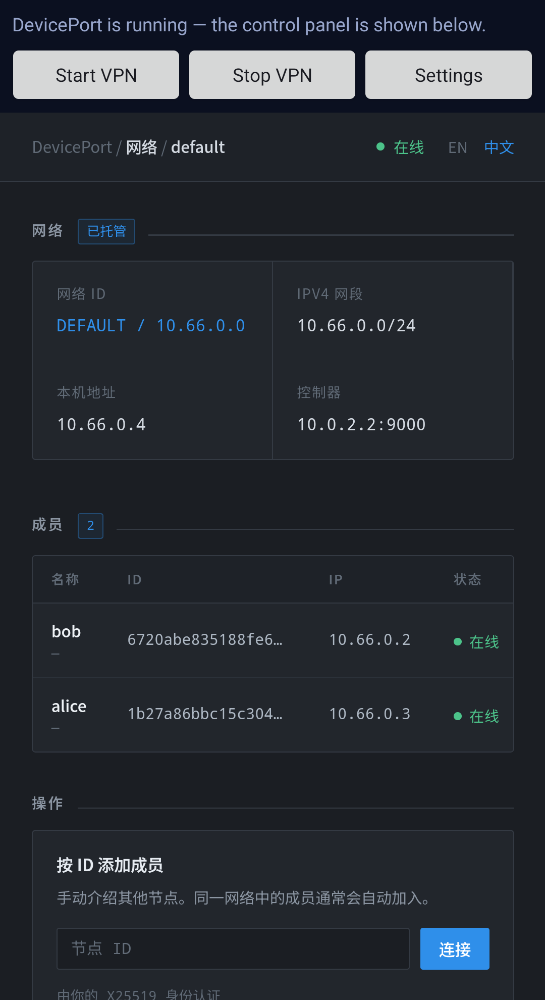

# DevicePort

[](https://github.com/GPUInAntarctica/DevicePort/actions/workflows/ci.yml)
[](LICENSE)
[](CHANGELOG.md)

**English** · [中文](#deviceport-1)

DevicePort builds a virtual LAN over an **IPv6 underlay**. Devices on different physical
networks join one overlay and receive a virtual **IPv4** address (`10.66.x.y`). Traffic is
**end-to-end encrypted**; peers use **UDP hole punching** with automatic **relay fallback**.
A ZeroTier-style bilingual (EN/中文) console, an Electron desktop shell and an Android VPN
app are included.

> Status: **v0.1.5** — functional prototype, not audited for production use.

## Download ready-to-run binaries

No build toolchain needed — grab the assets from the
[Releases / repository files](https://github.com/GPUInAntarctica/DevicePort/tree/master/dist):

| Platform | File | Run |
|----------|------|-----|
| Linux x86-64 | `dist/deviceport-linux-amd64` | `chmod +x deviceport-linux-amd64` |
| Windows x86-64 | `dist/deviceport-windows-amd64.exe` | double-click or run from PowerShell |
| Android | `dist/DevicePort-v0.1.5.apk` | install on device/emulator |

The Linux and Windows files are a **single executable** containing both roles:

```bash
# terminal 1 — server (signaling + relay + admin API)
./deviceport-linux-amd64 server --listen '[::]:9000' --subnet 10.66.0.0/24

# terminal 2 — node
./deviceport-linux-amd64 node --server '[::1]:9000' --name alice
```

On Windows: `deviceport-windows-amd64.exe server ...` and `... node ...`.
`deviceport` without a subcommand defaults to `node`. Run `deviceport help` for details.

## Features

- **IPv6 underlay / IPv4 overlay** with TUN interfaces on Linux, Windows (Wintun) and Android (VpnService).
- **Per-network authorization** — each network can require approval; pending members wait until an admin authorizes them via the admin API or CLI.
- **Replay protection** — 64-bit sequence numbers in authenticated frame headers with a sliding receive window.
- **Bounded direct links** — each node punches at most `--max-direct` peers (default 4), selected by XOR distance; the rest use the relay. No O(n²) full mesh.
- **Managed site-to-site routes** — the server pushes CIDRs with a gateway member; traffic for those subnets is encapsulated to the gateway.
- **Real peer status** — online/offline from live traffic, RTT measured with echoed keepalives, last-seen timestamps and dropped (replay) counters.
- **Encryption** — X25519 + HKDF-SHA256 + AES-256-GCM; relay server never sees keys.
- **Bilingual console** with member table, routes, authorization banner and ICMP test packet injector.
- **Electron desktop shell** with tray and bilingual menus.
- **Android settings page** for server address, network name and device name.

## Quick start from source

```bash
make build        # single executable in ./dist and ./bin
make test         # E2E (direct + relay), replay, auth, routes, crypto
```

## Authorization & admin

Enable approval for a network:

```bash
./dist/deviceport-linux-amd64 server --require-auth
# or per network: --auth-networks=teamA --noauth-networks=guests
```

A pending node shows an "awaiting authorization" banner and receives no peers. Approve it:

```bash
deviceportctl -admin http://127.0.0.1:9001 networks
deviceportctl -admin http://127.0.0.1:9001 auth <node-id> on
deviceportctl -admin http://127.0.0.1:9001 require-auth default on
```

Managed route (site-to-site):

```bash
deviceportctl -admin http://127.0.0.1:9001 route add default 192.168.1.0/24 <gateway-node-id>
```

## Screenshots

| Desktop (EN) | Desktop (中文) |
|--------------|----------------|
|  |  |

| Android (EN) | Android (中文) |
|--------------|----------------|
|  |  |

## Docs

- [Architecture](docs/ARCHITECTURE.md) · [Protocol v2](docs/PROTOCOL.md)
- [Windows / Wintun & Wine](docs/WINDOWS.md) · [Android APK & emulator](docs/ANDROID.md)
- [Desktop / Electron](docs/DESKTOP.md)

---

## DevicePort（中文）

DevicePort 通过 **IPv6 底层网络**构建虚拟局域网，为不同物理网络的设备分配虚拟 **IPv4** 地址。
流量端到端加密，通过 UDP 打洞直连，失败时自动中继。包含 ZeroTier 风格的中英双语控制台、
Electron 桌面端和 Android VPN 应用。

> 当前版本：**v0.1.5** — 功能原型，尚未经过生产安全审计。

### 直接下载

无需构建环境，直接使用仓库 `dist/` 中的资源：

| 平台 | 文件 |
|------|------|
| Linux x86-64 | `dist/deviceport-linux-amd64` |
| Windows x86-64 | `dist/deviceport-windows-amd64.exe` |
| Android | `dist/DevicePort-v0.1.5.apk` |

Linux/Windows 是**单文件可执行文件**，包含两个子命令：

```bash
./deviceport-linux-amd64 server --listen '[::]:9000' --subnet 10.66.0.0/24
./deviceport-linux-amd64 node --server '[::1]:9000' --name alice
```

### 主要特性

- **按网络授权**：每个网络可单独设置是否需要批准，待批准节点会显示提示且看不到其他成员。
- **重放保护**：序号写入认证头，接收端使用 64 位滑动窗口去重。
- **限制直连数量**：每个节点最多与 `--max-direct` 个节点打洞（默认 4），其余走中继，避免全互联的 O(n²)。
- **受管路由**：服务器下发网段及网关节点，实现站点到站点互通。
- **真实状态**：在线/离线、RTT（通过回显保活测量）、最后活动和重放丢弃计数。
- **Android 设置页**：可配置服务器地址、网络名和设备名。

### 从源码构建

```bash
make build
make test
```

## License

[MIT](LICENSE)
